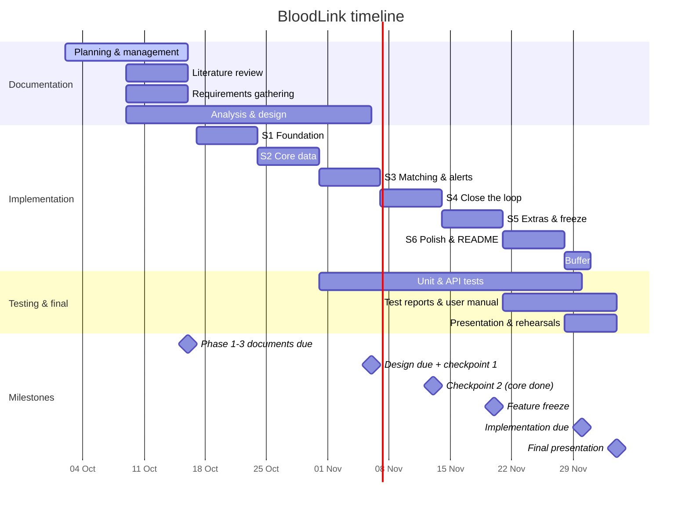

# Phase 1: Project Planning & Management

**Project:** BloodLink | رابط الحياة\
**Program:** DEPI (Digital Egypt Pioneers Initiative), 2026\
**Track:** Software Development - React Frontend Web Developer\
**Team:** Ibrahim Hassan Anwar, Khaled Atef Salah, Mohammed Eslam Mohammed, Hager Waleed Shaker, Zeyad Mohammed Mohammed, Marawan Hesham Tolba\
**Deadline:** 16 Oct 2026

## Contents

1. [Project Proposal](#1-project-proposal)
2. [Project Plan](#2-project-plan)
3. [Task Assignment & Roles](#3-task-assignment--roles)
4. [Risk Assessment & Mitigation Plan](#4-risk-assessment--mitigation-plan)
5. [KPIs](#5-kpis-key-performance-indicators)

---

## 1. Project Proposal

### Overview

BloodLink is a community website that connects people in Egypt who need blood with suitable donors nearby. Every request is backed by an official hospital paper. Donor and patient always meet at the hospital, and no money is involved.

### Problem

- Blood requests are spread through Facebook and WhatsApp posts that reach people by chance.
- Nobody can tell if a post is real or still needed.
- Most people who see a post have the wrong blood type or live too far away.
- Contact details are posted publicly, which invites scams and requests for money.

### Solution

| Step | What happens |
|---|---|
| Donor joins | Uploads an official hospital certificate showing their blood type |
| Patient asks | Uploads an official hospital paper proving the patient needs blood |
| Paper check | Partner hospital paper: confirmed by the hospital, badge **Verified**. Other official hospital: checked by AI, badge **Paper looks valid**. |
| Matching | Compatible, available donors closest to the hospital are notified first, and the area grows in waves |
| Accept | The donor accepts. Phone numbers are shared only then. |
| Meet | At the hospital. The hospital decides medically. Partner hospitals scan the donor's QR code to record the donation. |

### Objectives

1. Send each request only to donors who can actually help: compatible blood type, available, and nearby.
2. Show how much each request and donor can be trusted, using hospital papers and clear badges.
3. Protect users: phone numbers stay hidden until a donor accepts, meetings happen only at hospitals, and money requests are banned.
4. Deliver a working, deployed Arabic website that works well on phones and computers, by 30 Nov 2026.

### Scope

| In scope (core) | Out of scope |
|---|---|
| Accounts with 4 roles: donor, requester, partner hospital, admin | Examining donors or making any medical decision |
| Certificate and hospital paper upload | Guaranteeing a paper is genuine |
| AI paper check and partner-hospital confirmation | Payments of any kind |
| Matching by blood type, distance and trust level | SMS or WhatsApp Business API |
| Web push notifications in waves | Mobile apps (a possible future improvement; this project is a website only) |
| Accept or decline, with phone numbers hidden until acceptance | |
| QR check-in at partner hospitals; self-confirmation elsewhere | |
| Live request progress | |
| Admin: paper review, reports, bans, key numbers | |
| Arabic RTL interface that works on phones | |

**Planned extras (built only after checkpoint 2):** an English version, a map view, a WhatsApp share card, donation history and charts.

### Main deliverables

- Deployed website with demo data
- Source code on GitHub, with a README and API documentation
- Phase documents (planning, requirements, design, testing)
- Presentation, demo video and project infographic

---

## 2. Project Plan

### Timeline (Gantt chart)

The plan follows the DEPI deadlines. Implementation runs in six one-week sprints, Saturday to Friday, with a three-day buffer before the 30 Nov deadline.

### Sprints

| Sprint | Dates | Goal | Done when |
|---|---|---|---|
| S1 Foundation | 17 to 23 Oct | Repo, Docker, deploy, data models, login with roles, Arabic UI kit | The website is deployed and a user can log in with a role |
| S2 Core data | 24 to 30 Oct | Donor signup and certificate upload, request form and paper upload, partner confirmation | A request becomes active after the hospital confirms it |
| S3 Matching & alerts | 31 Oct to 6 Nov | Matching with tests, AI paper check, push notifications, accept or decline, live progress | **Checkpoint 1:** the whole flow works roughly |
| S4 Close the loop | 7 to 13 Nov | QR check-in at partner hospitals, self-confirmation elsewhere, waves, admin tools | **Checkpoint 2:** all core features are done |
| S5 Extras & freeze | 14 to 20 Nov | Planned extras (if checkpoint 2 passed), security, bug fixes | **Feature freeze** |
| S6 Polish | 21 to 27 Nov | Bug fixes only, README, API docs, demo data | Ready to submit |

### Milestones and deliverables

| Date | Milestone | Deliverable |
|---|---|---|
| 16 Oct | Phases 1 to 3 submitted | Planning, literature review and requirements documents |
| 23 Oct | Skeleton live | Deployed website with login |
| 6 Nov | Design submitted, checkpoint 1 | Diagrams, database design, wireframes, the end-to-end flow working roughly |
| 13 Nov | Checkpoint 2 | All core features working |
| 20 Nov | Feature freeze | No new features after this date |
| 30 Nov | Implementation submitted | Source code, README, deployed link |
| 4 Dec | Final presentation | Test reports, user manual, slides, demo video, infographic |

### Resource allocation

**Time (worst case).** Every member works about 10 hours a week for 8 weeks, from 9 Oct to 4 Dec.

| | Hours |
|---|---|
| Capacity: 6 members × 10 h × 8 weeks | 480 |
| Weekly meetings (1 h each per week) | −48 |
| One member loses a full week | −10 |
| **Available** | **422** |
| Core development (estimates × 1.5 safety factor) | 167 |
| Planned extras (× 1.5) | 59 |
| Integration and testing | 40 |
| Documentation for all phases (× 1.5) | 60 |
| Research, presentation, video, rehearsals (× 1.5) | 30 |
| **Planned** | **356** |
| **Spare** | **≈ 66** |

The spare hours cover delays and bugs. The extras start only after checkpoint 2, so the core is always finished first.

| Member | Development | Docs & presentation | Total (of 72 h) |
|---|---|---|---|
| Ibrahim Hassan Anwar (team leader) | ≈ 47 h | ≈ 12 h | ≈ 59 h |
| Zeyad Mohammed Mohammed | ≈ 47 h | ≈ 12 h | ≈ 59 h |
| Hager Waleed Shaker | ≈ 47 h | ≈ 12 h | ≈ 59 h |
| Mohammed Eslam Mohammed | ≈ 47 h | ≈ 12 h | ≈ 59 h |
| Marawan Hesham Tolba | ≈ 47 h | ≈ 12 h | ≈ 59 h |
| Khaled Atef Salah | ≈ 47 h | ≈ 12 h | ≈ 59 h |

**Tools and services (cost: $0).**

| Need | Tool | Plan |
|---|---|---|
| Code and tasks | GitHub, GitHub Projects, GitHub Actions | Free |
| Frontend hosting | Vercel | Free (Hobby) |
| Backend hosting | Render (Docker) | Free, kept awake with an uptime ping |
| Database | MongoDB Atlas | Free (M0) |
| File storage | Cloudinary | Free tier |
| AI paper check | Mock mode for development, free AI tier for the demo with sample papers only | Free |
| Design | Figma | Free |

At launch, the only real cost would be a paid AI model for real papers (roughly $3 to $12 per 1,000 papers).

---

## 3. Task Assignment & Roles

### Roles

All six members have the same amount of work. **Ibrahim Hassan Anwar is the team leader.** Besides his own area, he set up the project and the repository, and he has the final say on scope.

We build the whole **frontend first**, with sample data, and each member owns **one area of the website** from start to finish. Each area has about the same amount of work: one big, one medium and one small page, or the equivalent.

| Member | Role | Area | Pages |
|---|---|---|---|
| Ibrahim Hassan Anwar | **Team leader** · Visitors | Public pages | Home, Signup, Login, plus the project setup |
| Zeyad Mohammed Mohammed | Donor | Donor pages | Nearby requests, Upload certificate, Donation history |
| Hager Waleed Shaker | Donation | The donation itself | Request details (accept, QR or no QR), Confirm donation, Terms of use + 404 |
| Mohammed Eslam Mohammed | Requester | Requester pages | New request (4 steps + hospital paper), Request progress |
| Marawan Hesham Tolba | Hospital | Partner hospital pages | Hospital dashboard (QR scan), Confirm papers, Hospital signup |
| Khaled Atef Salah | Admin | Admin pages | Admin dashboard, Review papers, Reports and bans, Approve hospitals |

Each member also builds the shared parts their pages need, and documents and tests their own area. The backend will be split between the members once the frontend is finished.

### Documents

The team leader collects each phase document and submits it. Everyone contributes, and each member writes the parts about their own area.

### How we work

- **Board:** GitHub Projects, with the columns To do, In progress and Done.
- **Meetings:** a 1-hour planning meeting at the start of each sprint, and a short written update every two days.
- **Code:** one branch per task. Each member checks their work (`npm run lint` and `npm run build`), opens a pull request and squash-merges it into `main`.
- **Decisions:** after sprint 2, only the team leader can add new features to the plan.

---

## 4. Risk Assessment & Mitigation Plan

| # | Risk | Likelihood | Impact | Mitigation |
|---|---|---|---|---|
| 1 | A team member is unavailable for a week or more | Medium | High | Hours planned for the worst case. Each area is documented and uses the same shared components, so another member can cover it. |
| 2 | The work runs out of time | Medium | High | A fixed core scope, checkpoints on 6 and 13 Nov, a feature freeze on 20 Nov and a 3-day buffer. |
| 3 | Six people working on the same code cause conflicts or duplicated work | Medium | Medium | Each member owns clear folders and features, pull requests stay small, and there's a short written update every two days. |
| 4 | Documentation takes time away from coding | High | Medium | Each phase has one owner, diagrams are written as code in the repo, and documents are written while the feature is being built. |
| 5 | The AI marks a fake paper "looks valid" | Medium | Medium | The badge never claims a paper is genuine. Users accept terms saying they are responsible for their papers. Users can report, and abusers are banned. Partner hospitals give the stronger badge. |
| 6 | The free AI service is slow or down during the demo | Medium | High | Mock mode (`AI_PROVIDER=mock`), papers checked in advance and a recorded backup video. |
| 7 | Push notifications are hard to get working | Medium | Medium | Started early in sprint 3. Live updates on the website are the fallback. Demo on Android Chrome. |
| 8 | The free server sleeps and misses notification waves | High | Low | An uptime ping every 5 to 10 minutes. |
| 9 | No real hospital agrees to partner before the demo | High | Low | Demo hospitals have clearly fictional names. We never claim a partnership that doesn't exist. |
| 10 | Users' personal data or papers leak | Low | High | Papers are private files, phone numbers are hidden until a donor accepts, no secrets go in the repo, and only sample papers are sent to the free AI. We follow Egypt's Personal Data Protection Law (151/2020). |
| 11 | People ask for money or misuse the platform | Medium | High | Clear "no money" rules on every screen, a report button and admin bans. |
| 12 | Users see us as responsible for medical outcomes | Low | High | Terms of use say we only connect people. The hospital makes every medical decision. |

---

## 5. KPIs (Key Performance Indicators)

These are targets we set for the demo and a small pilot. They are not measured results yet.

### Product

| KPI | Target | How we measure |
|---|---|---|
| Time from request to first donor accepting | Under 30 minutes in the demo | Timestamps stored on each request |
| Requests that reach at least one accepting donor | ≥ 70 % in the pilot | Admin dashboard |
| Notified donors who accept or decline | ≥ 50 % | Notification and response logs |
| Requests that have a hospital paper | 100 % | Enforced by the system |
| Abuse reports handled by an admin | 100 % within 24 hours | Report status and timestamps |

### Technical

| KPI | Target | How we measure |
|---|---|---|
| API response time | 95 % of requests under 500 ms | Server logs |
| Uptime during demo week | ≥ 99 % | Uptime monitor |
| Page load on a phone over 4G | Under 3 seconds | Lighthouse |
| Accessibility score | ≥ 90 | Lighthouse |
| Test coverage of core logic (matching, trust badges, request states) | ≥ 70 % | Jest coverage report |

### Adoption (pilot)

| KPI | Target | How we measure |
|---|---|---|
| Registered donors | 50 | Database count |
| Donors with an uploaded certificate | ≥ 60 % of registered donors | Database count |
| Partner hospitals | At least 1 real partner talked to | Outreach log |

### Project delivery

| KPI | Target |
|---|---|
| Phase documents submitted on time | 7 of 7 |
| Core features done by checkpoint 2 (13 Nov) | 100 % |
| Pull requests reviewed before merging | 100 % |
| Critical bugs open at submission | 0 |
