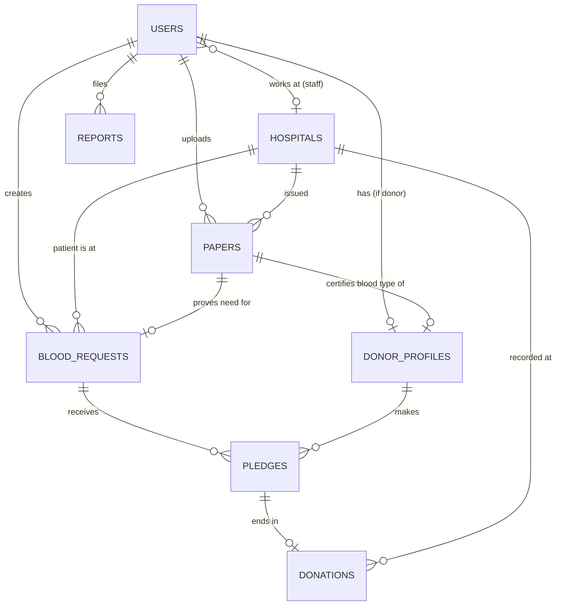
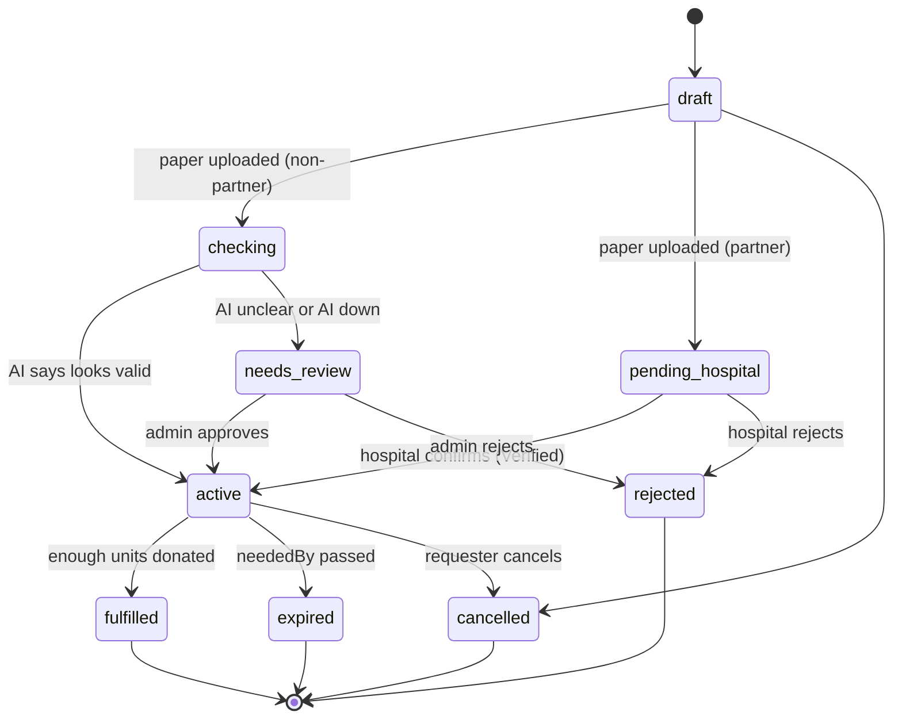
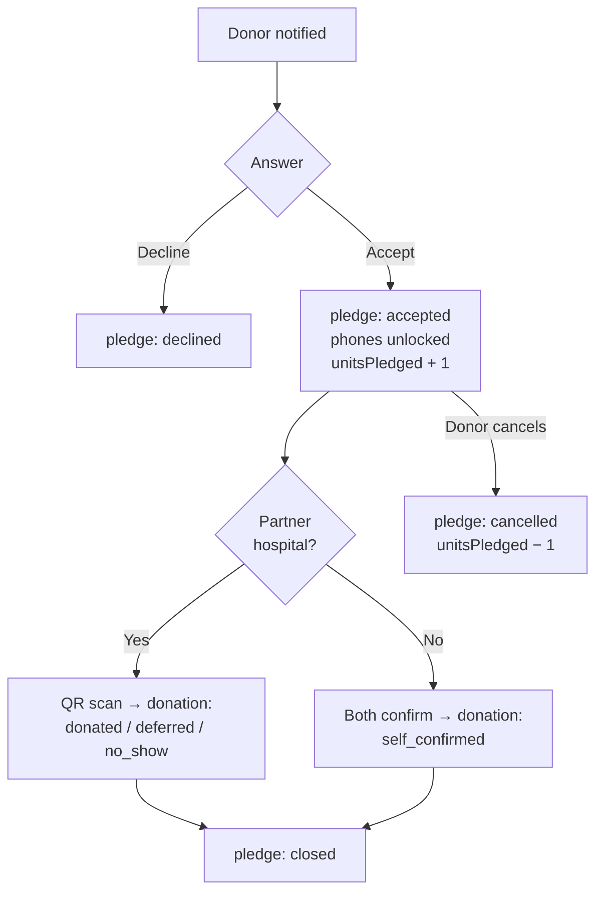

# Database Design

**Project:** BloodLink | رابط الحياة\
**Program:** DEPI (Digital Egypt Pioneers Initiative), 2026\
**Track:** Software Development - React Frontend Web Developer\
**Team:** Ibrahim Hassan Anwar, Khaled Atef Salah, Mohammed Eslam Mohammed, Hager Waleed Shaker, Zeyad Mohammed Mohammed, Marawan Hesham Tolba\
**Deadline:** 31 Oct 2026

## Contents

1. [Overview](#1-overview)
2. [Entity relationship diagram](#2-entity-relationship-diagram)
3. [Collections](#3-collections)
4. [Shared values (enums)](#4-shared-values-enums)
5. [Status lifecycles](#5-status-lifecycles)
6. [Indexes](#6-indexes)
7. [Key queries](#7-key-queries)
8. [Privacy and security rules](#8-privacy-and-security-rules)
9. [Validation and data rules](#9-validation-and-data-rules)
10. [Example documents](#10-example-documents)

---

## 1. Overview

| | Choice | Why |
|---|---|---|
| **Database** | MongoDB Atlas (free M0 cluster) | Flexible documents fit papers, AI results and request history. Built-in geo queries for "donors near this hospital". Free for the demo. |
| **Access** | Mongoose models in the TypeScript backend (Node + Express) | Schemas, validation and references in one place. Taught in the course. |
| **Files** | Cloudinary (private, signed URLs) | Paper images and PDFs are never stored in the database, only their private file reference. |
| **Live updates** | Socket.io on top of the database | When a pledge is saved, the requester's page updates without a refresh. |

**Design rules**

1. **One collection per main thing** a user can point at: a user, a hospital, a paper, a request, a pledge, a donation, a report.
2. **Reference, don't copy,** for things that change (a hospital's name, a user's phone). **Embed** small things that belong to one parent only (a request's history, an AI result).
3. **Every document has a human reference number** (like `BL-2026-004213`) next to its database `_id`, so users and support can talk about the same item.
4. **Private by default.** Phone numbers and papers are only returned by the API in the cases listed in [section 8](#8-privacy-and-security-rules).
5. **Times are stored in UTC.** The website shows them in Cairo time.

**Collections at a glance**

| Collection | Holds |
|---|---|
| `users` | Every account: name, phone, password hash, roles |
| `donorProfiles` | Donor-only data: blood type, location, availability, trust |
| `hospitals` | All hospitals, partner or not |
| `papers` | Uploaded certificates and hospital papers, with the check result |
| `bloodRequests` | Requests for blood |
| `pledges` | A donor's answer to a request (accept / decline), with the QR token |
| `donations` | What actually happened at the hospital |
| `notifications` | Who was notified about which request, in which wave |
| `pushSubscriptions` | Browser push endpoints |
| `reports` | Reports about users or requests |
| `auditLogs` | Every admin and hospital-staff action |
| `settings` | One document: wave radius, pause period, AI mode |
| `counters` | Next number for each reference type |

## 2. Entity relationship diagram



The fields of each collection are listed in [section 3](#3-collections). The diagram shows the 8 core collections. The others only point at users and requests: `notifications` (user + request), `pushSubscriptions` (user) and `auditLogs` (the acting user). `settings` and `counters` stand alone.

**Reading the main relationships**

- A **user** can be a donor, a requester, or both. Only donors have a **donor profile** (one each).
- Hospital **staff** are users with the `hospital_staff` role and a `hospitalId`.
- A **request** belongs to one requester and one hospital, and is backed by exactly one **paper**.
- A **pledge** links one donor to one request. A request has many pledges, one per donor who answered.
- A pledge ends in at most one **donation** record: donated, not today, didn't show up, or self-confirmed.

## 3. Collections

Every collection also has `createdAt` and `updatedAt` (added automatically by Mongoose).

### 3.1 `users`

| Field | Type | Rules | Notes |
|---|---|---|---|
| `_id` | ObjectId | | |
| `name` | string | required, 3–80 chars | Full name in Arabic |
| `phone` | string | required, unique, Egyptian mobile `01XXXXXXXXX` | **Private** (section 8) |
| `email` | string | optional, unique when present, lowercase | Login with email or phone |
| `passwordHash` | string | required | bcrypt, never returned by the API |
| `roles` | string[] | at least 1 of `donor`, `requester`, `hospital_staff`, `admin` | Donor + requester together is allowed |
| `hospitalId` | ObjectId → `hospitals` | required if `hospital_staff` | |
| `termsAcceptedAt` | date | required | When the user accepted the terms of use |
| `aiConsentAt` | date | optional | Consent before a paper goes to the AI check |
| `status` | string | `active`, `warned`, `banned` | Banned users can't log in |
| `ban` | object | `{ reason, by, at }` | Set by an admin |
| `lastLoginAt` | date | | |

### 3.2 `donorProfiles`

| Field | Type | Rules | Notes |
|---|---|---|---|
| `userId` | ObjectId → `users` | required, unique | One profile per donor |
| `ref` | string | unique, `DN-2026-01877` | Shown on the donor's ID card |
| `bloodType` | string | one of the 8 blood types | From the certificate |
| `governorate`, `area` | string | required | For display and filters |
| `location` | GeoJSON Point | required, `[longitude, latitude]` | Used for distance matching |
| `isAvailable` | boolean | default `true` | The availability switch |
| `pausedUntil` | date | optional | Set after a donation or by the donor |
| `trustLevel` | string | `pending`, `needs_review`, `looks_valid`, `verified` | Copied from the certificate's result |
| `certificatePaperId` | ObjectId → `papers` | | The current certificate |
| `stats` | object | `{ donations, noShows, lastDonationAt }` | Kept up to date when a donation is recorded |

### 3.3 `hospitals`

| Field | Type | Rules | Notes |
|---|---|---|---|
| `ref` | string | unique, `HP-0007` | |
| `name` | string | required | e.g. "مستشفى النور" |
| `type` | string | `public`, `private`, `university`, `military` | |
| `governorate`, `area`, `address` | string | required | |
| `location` | GeoJSON Point | required | Matching measures distance from here |
| `isPartner` | boolean | default `false` | Only partners can confirm papers and scan QR codes |
| `partnerStatus` | string | `none`, `pending`, `approved`, `rejected` | Partner accounts wait for admin approval |
| `partnerRequest` | object | `{ contactName, contactPhone, documentPaperId, submittedAt }` | From the hospital signup form |
| `approvedBy`, `approvedAt` | ObjectId → `users`, date | | |
| `bloodBank` | object | `{ building, floor, hours, phone }` | Directions shown to donors after accepting |

Non-partner hospitals are also stored, so requests can point at them and donors see the address.

### 3.4 `papers`

One document per uploaded file: a donor's blood-type certificate or a requester's hospital paper.

| Field | Type | Rules | Notes |
|---|---|---|---|
| `ownerId` | ObjectId → `users` | required | Who uploaded it |
| `kind` | string | `donor_certificate`, `need_paper`, `hospital_license` | |
| `hospitalId` | ObjectId → `hospitals` | required | The hospital that issued it |
| `fromPartner` | boolean | | Copied from the hospital at upload time |
| `file` | object | `{ publicId, mime, sizeBytes }`; JPG, PNG or PDF, ≤ 5 MB | Cloudinary private file. **Never public** |
| `ai` | object | `{ provider, result, extracted, problems, checkedAt }` | Only for non-partner papers |
| `ai.extracted` | object | `{ name, bloodType, stampVisible, issueDate }` | What the AI could read |
| `status` | string | see [5.2](#52-paper-and-trust-level) | |
| `review` | object | `{ by, at, decision, note }` | Partner staff or admin decision |
| `expiresAt` | date | | Need papers are only valid for a short time |

### 3.5 `bloodRequests`

| Field | Type | Rules | Notes |
|---|---|---|---|
| `ref` | string | unique, `BL-2026-004213` | Used in the status lookup and WhatsApp share |
| `createdBy` | ObjectId → `users` | required | The requester |
| `patient` | object | `{ name, age, department }` | Shown only to accepted donors and hospital staff |
| `bloodType` | string | one of the 8 blood types | The patient's type |
| `component` | string | `whole_blood`, `platelets`, `plasma` | |
| `unitsNeeded` | number | 1–10 | |
| `unitsPledged` | number | ≥ 0 | Accepted pledges still open. Kept in sync for the live counter |
| `unitsDonated` | number | ≥ 0 | |
| `urgency` | string | `urgent`, `normal` | |
| `neededBy` | date | required, in the future | The request expires after this |
| `hospitalId` | ObjectId → `hospitals` | required | |
| `paperId` | ObjectId → `papers` | required | Can't be published without it |
| `trustLevel` | string | copied from the paper | The badge donors see |
| `status` | string | see [5.1](#51-blood-request) | |
| `wave` | object | `{ number, radiusKm, startedAt, nextAt }` | 1 = 5 km, 2 = 15 km |
| `history` | array of `{ at, event, by }` | embedded, append-only | The timeline on the progress page |

### 3.6 `pledges`

Created when a donor answers a request.

| Field | Type | Rules | Notes |
|---|---|---|---|
| `ref` | string | unique, `AP-2026-118204` | Shown on the donor's ticket |
| `requestId` | ObjectId → `bloodRequests` | required | |
| `donorId` | ObjectId → `donorProfiles` | required | One pledge per donor per request (unique pair) |
| `status` | string | `accepted`, `declined`, `cancelled`, `closed` | |
| `wave` | number | | Which wave reached this donor |
| `distanceKm` | number | | Donor to hospital, at the time of matching |
| `qrToken` | string | unique, random, only for partner hospitals | Encoded in the QR code |
| `qrExpiresAt` | date | | Valid until the request's deadline |
| `acceptedAt`, `answeredAt` | date | | `acceptedAt` unlocks phone numbers |

### 3.7 `donations`

| Field | Type | Rules | Notes |
|---|---|---|---|
| `pledgeId` | ObjectId → `pledges` | required, unique | |
| `requestId`, `donorId`, `hospitalId` | ObjectId | required | Copied for fast history and statistics queries |
| `outcome` | string | `donated`, `deferred`, `no_show`, `self_confirmed` | `deferred` = "not able to donate today (medical decision)" |
| `method` | string | `qr_scan`, `self_confirmation` | |
| `recordedBy` | ObjectId → `users` | for `qr_scan` | The hospital staff member |
| `confirmations` | object | `{ donorAt, requesterAt }` | For `self_confirmation`: both must confirm |
| `staffNote` | string | optional, ≤ 200 chars | Internal, admin only. **No medical details.** |
| `at` | date | required | |

### 3.8 `notifications`

| Field | Type | Notes |
|---|---|---|
| `userId` | ObjectId → `users` | The donor |
| `requestId` | ObjectId → `bloodRequests` | |
| `wave` | number | So the same donor is never notified twice for one request |
| `channel` | string | `push`, `in_app` |
| `sentAt`, `readAt` | date | |

### 3.9 `pushSubscriptions`

| Field | Type | Notes |
|---|---|---|
| `userId` | ObjectId → `users` | One user can have several browsers |
| `endpoint` | string, unique | From the browser's Push API |
| `keys` | object `{ p256dh, auth }` | |
| `failedAt` | date | Removed after repeated failures |

### 3.10 `reports`

| Field | Type | Rules | Notes |
|---|---|---|---|
| `ref` | string | unique, `RP-2026-000412` | |
| `reporterId` | ObjectId → `users` | required | |
| `target` | object | `{ kind: 'user' \| 'request', id }` | Report button on every profile and request |
| `reason` | string | `money_request`, `fake_paper`, `harassment`, `no_show`, `other` | Asking for money = highest priority |
| `details` | string | ≤ 500 chars | |
| `status` | string | `open`, `dismissed`, `warned`, `banned` | What the admin decided |
| `handledBy`, `handledAt` | ObjectId, date | | |

### 3.11 `auditLogs`

Every admin and hospital-staff action is logged with the actor's name: paper decisions, bans, hospital approvals, QR scans.

| Field | Type | Notes |
|---|---|---|
| `actorId` | ObjectId → `users` | |
| `action` | string | e.g. `paper.approve`, `user.ban`, `donation.record` |
| `target` | object `{ collection, id, ref }` | |
| `at` | date | |
| `details` | object | Short, no personal data beyond the reference |

### 3.12 `settings` and `counters`

`settings` holds **one document** that admins can change without a new deploy:

| Field | Default | Used for |
|---|---|---|
| `waveRadiiKm` | `[5, 15]` | Wave 1 and wave 2 search radius |
| `waveDelayMinutes` | `120` | Time before the next wave starts |
| `pauseDaysAfterDonation` | `90` | General guidance; the hospital decides |
| `aiProvider` | `mock` | `mock` or a real provider |
| `needPaperMaxAgeDays` | `7` | How recent a hospital paper must be |

`counters` makes reference numbers: `{ _id: 'BL-2026', seq: 4213 }`. The backend increments it atomically with `findOneAndUpdate({ $inc: { seq: 1 } })`.

## 4. Shared values (enums)

These lists are shared by the database, the API and the frontend constants, so a value is spelled the same everywhere.

| Name | Values |
|---|---|
| Blood types | `O-`, `O+`, `A-`, `A+`, `B-`, `B+`, `AB-`, `AB+` |
| Roles | `donor`, `requester`, `hospital_staff`, `admin` |
| Trust levels | `verified`, `looks_valid`, `needs_review`, `pending` |
| Request status | `draft`, `checking`, `pending_hospital`, `needs_review`, `active`, `fulfilled`, `expired`, `rejected`, `cancelled` |
| Pledge status | `accepted`, `declined`, `cancelled`, `closed` |
| Donation outcome | `donated`, `deferred`, `no_show`, `self_confirmed` |
| Report status | `open`, `dismissed`, `warned`, `banned` |

**Blood compatibility** (used by matching). Which donors can give to a patient:

| Patient | Compatible donors |
|---|---|
| O− | O− |
| O+ | O−, O+ |
| A− | O−, A− |
| A+ | O−, O+, A−, A+ |
| B− | O−, B− |
| B+ | O−, O+, B−, B+ |
| AB− | O−, A−, B−, AB− |
| AB+ | All 8 types |

This table lives in code (a constant), not in the database, because it never changes.

## 5. Status lifecycles

### 5.1 Blood request



Only `active` requests are matched and shown to donors.

### 5.2 Paper and trust level

| Paper status | When | Trust level given |
|---|---|---|
| `pending_hospital` | Uploaded, issued by a partner hospital | `pending` |
| `verified` | The partner hospital confirmed "issued by us" | `verified` (**Verified**) |
| `looks_valid` | Non-partner, the AI read it and found no problems | `looks_valid` (**Paper looks valid**) |
| `needs_review` | The AI couldn't read it, or the AI service is down | `needs_review` |
| `rejected` | Hospital or admin rejected it | (request can't be published) |

A self-confirmed donation at a non-partner hospital **never** upgrades a donor to `verified`. Only a QR scan at a partner hospital can.

### 5.3 Pledge and donation



## 6. Indexes

| Collection | Index | Why |
|---|---|---|
| `users` | `{ phone: 1 }` unique | Login and duplicate check |
| `users` | `{ email: 1 }` unique, sparse | Email is optional |
| `donorProfiles` | `{ location: '2dsphere' }` | Find donors within 5 / 15 km |
| `donorProfiles` | `{ bloodType: 1, isAvailable: 1, pausedUntil: 1 }` | Filter matching donors fast |
| `donorProfiles` | `{ userId: 1 }` unique, `{ ref: 1 }` unique | |
| `hospitals` | `{ location: '2dsphere' }`, `{ ref: 1 }` unique, `{ isPartner: 1 }` | Nearby requests, partner list |
| `bloodRequests` | `{ ref: 1 }` unique | Status lookup by reference |
| `bloodRequests` | `{ status: 1, neededBy: 1 }` | Active list and the expiry job |
| `bloodRequests` | `{ createdBy: 1, createdAt: -1 }` | "My requests" |
| `bloodRequests` | `{ hospitalId: 1, status: 1 }` | Hospital dashboard |
| `papers` | `{ status: 1, kind: 1, createdAt: 1 }` | Admin and hospital queues, oldest first |
| `papers` | `{ hospitalId: 1, status: 1 }` | "Papers waiting" for one hospital |
| `pledges` | `{ requestId: 1, donorId: 1 }` unique | One answer per donor per request |
| `pledges` | `{ donorId: 1, status: 1 }` | Donor's appointments |
| `pledges` | `{ qrToken: 1 }` unique, sparse | QR scan lookup |
| `donations` | `{ donorId: 1, at: -1 }` | Donation history |
| `donations` | `{ hospitalId: 1, at: -1 }` | Hospital's log |
| `notifications` | `{ requestId: 1, userId: 1 }` unique | Never notify twice |
| `reports` | `{ status: 1, reason: 1, createdAt: 1 }` | Admin queue, money requests first |
| `auditLogs` | `{ at: -1 }`, `{ actorId: 1, at: -1 }` | |

## 7. Key queries

**Matching: donors for a request.** One geo query, run per wave:

```js
db.donorProfiles.aggregate([
  { $geoNear: {
      near: hospital.location,               // the request's hospital
      distanceField: 'distanceM',
      maxDistance: wave.radiusKm * 1000,     // 5 km, then 15 km
      query: {
        bloodType: { $in: COMPATIBLE_DONORS[request.bloodType] },
        isAvailable: true,
        $or: [{ pausedUntil: null }, { pausedUntil: { $lt: now } }],
        trustLevel: { $in: ['verified', 'looks_valid'] },
      },
  } },
  // then: remove banned users, donors already notified, and the requester themself
  { $limit: 50 },
]);
```

Closest and most trusted donors come first. Banned users and donors already in `notifications` for this request are filtered out.

**Live counter.** When a pledge is accepted or cancelled, `unitsPledged` is changed with `$inc` in the same operation, and Socket.io sends the new number to the request's room.

**Expiry job.** Every 10 minutes: `updateMany({ status: 'active', neededBy: { $lt: now } }, { $set: { status: 'expired' } })`.

**Admin key numbers.** Counts on `bloodRequests` (active), `donorProfiles`, `reports` (open), and the average time from a request's `createdAt` to its first pledge's `acceptedAt`.

## 8. Privacy and security rules

The database stores personal data, so the API decides exactly who can see what (Egypt's Personal Data Protection Law 151/2020).

| Data | Who can see it |
|---|---|
| Donor's phone | The requester, **only after** that donor accepted their request |
| Requester's phone | A donor, **only after** they accepted that request |
| Paper files | The owner, the issuing partner hospital's staff (to confirm it), and admins. **Never** other users |
| Patient name and department | Accepted donors of that request, and hospital staff |
| `passwordHash`, `qrToken` | Never returned, except the donor's own QR token on their ticket |
| `staffNote` on donations | Admins only |
| Reports | The reporter and admins. The reported user never sees who reported them |

**Other rules**

- Passwords are hashed with bcrypt. Login uses a JWT in an httpOnly cookie.
- Every input is validated with zod before it reaches Mongoose.
- Connection strings and keys live only in `.env`, never in the repo.
- Only sample papers are sent to the free AI tier.
- Database users: the app connects with a user that can only read and write the `bloodlink` database.

## 9. Validation and data rules

| Rule | Where |
|---|---|
| Phone matches `^01[0125][0-9]{8}$` (Egyptian mobile) | zod + Mongoose |
| Files: JPG, PNG or PDF, max 5 MB | Upload middleware |
| A request needs `paperId`, and `neededBy` in the future | zod + Mongoose |
| `unitsPledged` ≤ `unitsNeeded` + 1 (one spare donor allowed) | Service layer, in the same update |
| One pledge per donor per request | Unique index |
| A donor can't pledge to their own request | Service layer |
| A donor who is paused, unavailable or banned is never matched | Matching query |
| Deleting is soft: banned users are kept (with `status: 'banned'`), so reports and history stay correct | Service layer |
| Reference numbers are never reused | `counters` collection |

**Retention.** Paper files are deleted from Cloudinary 90 days after the request ends. Request and donation records are kept for history and statistics, without the files.

## 10. Example documents

A request (`bloodRequests`):

```json
{
  "_id": "6721f3a0c2b1a4e5f0a10001",
  "ref": "BL-2026-004213",
  "createdBy": "6721f2ffc2b1a4e5f0a0aaa1",
  "patient": { "name": "سارة إبراهيم", "age": 54, "department": "قسم الجراحة" },
  "bloodType": "O+",
  "component": "whole_blood",
  "unitsNeeded": 3,
  "unitsPledged": 2,
  "unitsDonated": 0,
  "urgency": "urgent",
  "neededBy": "2026-10-23T03:00:00Z",
  "hospitalId": "6721f100c2b1a4e5f0a00007",
  "paperId": "6721f390c2b1a4e5f0a0f001",
  "trustLevel": "verified",
  "status": "active",
  "wave": { "number": 1, "radiusKm": 5, "startedAt": "2026-10-22T07:12:00Z" },
  "history": [
    { "at": "2026-10-22T07:05:00Z", "event": "created" },
    { "at": "2026-10-22T07:10:00Z", "event": "paper_verified", "by": "6721f2aac2b1a4e5f0a0bbb2" },
    { "at": "2026-10-22T07:12:00Z", "event": "wave_started", "wave": 1 }
  ]
}
```

A pledge (`pledges`) at a partner hospital:

```json
{
  "_id": "6721f5d0c2b1a4e5f0a20001",
  "ref": "AP-2026-118204",
  "requestId": "6721f3a0c2b1a4e5f0a10001",
  "donorId": "6721f222c2b1a4e5f0a0d001",
  "status": "accepted",
  "wave": 1,
  "distanceKm": 2.4,
  "qrToken": "q_8f3a1c9e7b2d4f60",
  "qrExpiresAt": "2026-10-23T03:00:00Z",
  "acceptedAt": "2026-10-22T07:52:00Z"
}
```

A donor profile (`donorProfiles`):

```json
{
  "_id": "6721f222c2b1a4e5f0a0d001",
  "userId": "6721f1eec2b1a4e5f0a0ccc1",
  "ref": "DN-2026-01877",
  "bloodType": "O+",
  "governorate": "القاهرة",
  "area": "مدينة نصر",
  "location": { "type": "Point", "coordinates": [31.3301, 30.0561] },
  "isAvailable": true,
  "pausedUntil": null,
  "trustLevel": "verified",
  "certificatePaperId": "6721f230c2b1a4e5f0a0f0c1",
  "stats": { "donations": 4, "noShows": 0, "lastDonationAt": "2026-06-07T09:20:00Z" }
}
```

All examples use fictional people and hospitals.
