# UI/UX Design

**Project:** BloodLink | رابط الحياة\
**Program:** DEPI (Digital Egypt Pioneers Initiative), 2026\
**Track:** Software Development - React Frontend Web Developer\
**Team:** Ibrahim Hassan Anwar, Khaled Atef Salah, Mohammed Eslam Mohammed, Hager Waleed Shaker, Zeyad Mohammed Mohammed, Marawan Hesham Tolba\
**Deadline:** 31 Oct 2026

## Contents

1. [Design goals](#1-design-goals)
2. [Users and key flows](#2-users-and-key-flows)
3. [Information architecture](#3-information-architecture)
4. [Screens](#4-screens)
5. [Visual design system](#5-visual-design-system)
6. [Components](#6-components)
7. [Screen states](#7-screen-states)
8. [Accessibility](#8-accessibility)
9. [Responsive design](#9-responsive-design)
10. [Content and tone](#10-content-and-tone)
11. [Usability testing plan](#11-usability-testing-plan)
12. [From design to code](#12-from-design-to-code)

---

## 1. Design goals

People open BloodLink at a stressful moment: a relative needs blood, often today. The design has to feel **official enough to trust** and **simple enough to use in a hurry**, on a cheap phone, in Arabic.

| Goal | What it means in the design |
|---|---|
| **Trust first** | Every request and donor shows a trust badge (**Verified**, **Paper looks valid**, **Needs review**). A calm navy-and-gold "public service" look, a seal logo, and reference numbers on every request. |
| **Fast under stress** | One main action per screen. Big buttons. The request form is split into 4 short steps, and the draft saves itself. |
| **Safety built in** | Phone numbers stay hidden until the donor accepts. "Meet only inside the hospital" and "No money, ever" appear on every key screen. |
| **We connect, the hospital decides** | No medical wording or decisions in the UI. Outcomes like "Not able to donate today" are labelled as the hospital's medical decision. |
| **Arabic first** | Right-to-left layout, Arabic fonts made for screens, numbers and codes kept left-to-right where needed. |
| **For everyone** | Text size, high contrast and dark mode on every page. Works with a keyboard and a screen reader. Works from 360 px wide. |

## 2. Users and key flows

| User | Main goal | Main screens |
|---|---|---|
| **Requester** (a patient's family member) | Find compatible donors fast | New request (4 steps), Request progress, Confirm donation |
| **Donor** | See real requests near home and help | Nearby requests, Request details, Certificate upload, Donation history |
| **Partner hospital staff** | Confirm papers and record donations | Hospital dashboard (QR scan), Papers waiting for confirmation |
| **Admin** | Keep the platform safe | Admin dashboard, Unclear papers, Reports and bans, Hospital approvals |

### Requester flow

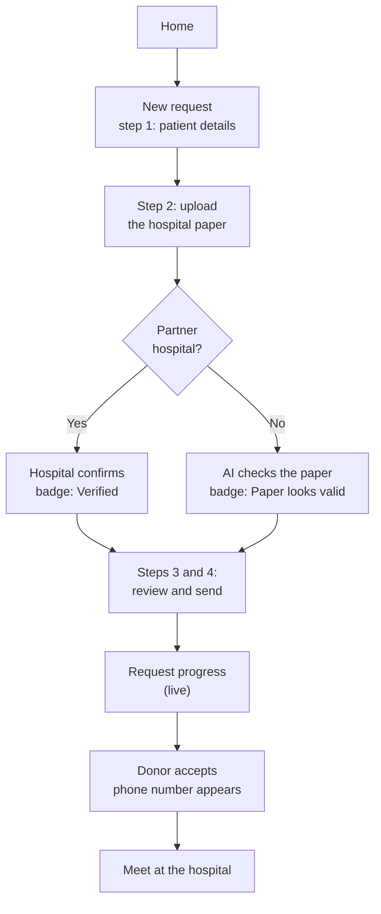

### Donor flow

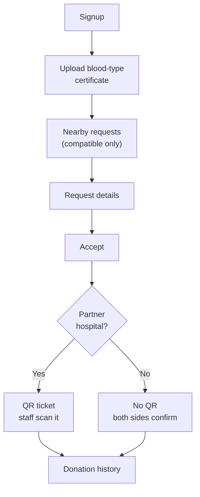

### Hospital and admin flows

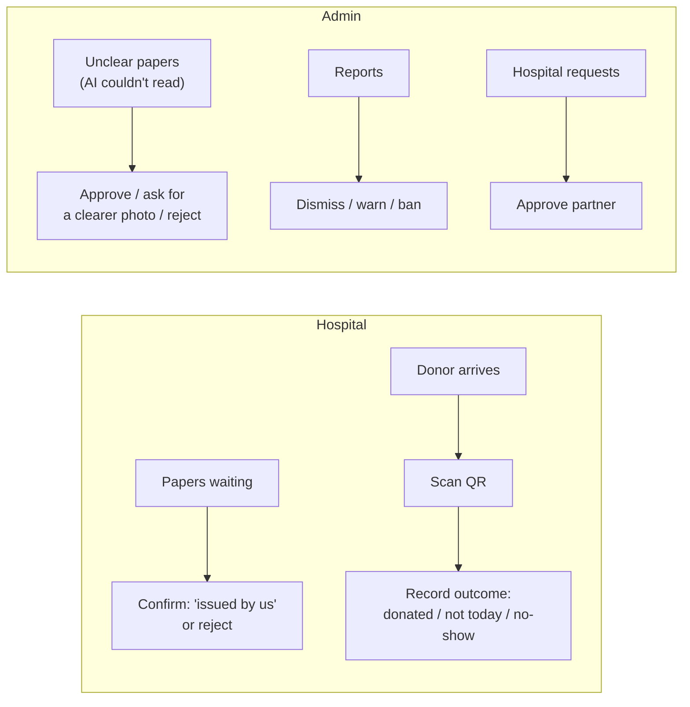

## 3. Information architecture

The site has **18 screens** in 5 areas. Each user sees only their own area after login.

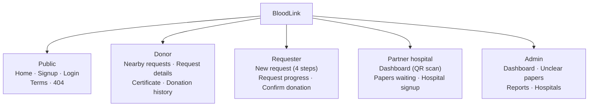

| Area | Screen | Route |
|---|---|---|
| Public | Home | `/` |
| Public | Signup | `/signup` |
| Public | Login | `/login` |
| Public | Terms of use + 404 | `/terms`, `*` |
| Donor | Nearby requests + availability switch | `/donor/requests` |
| Donor | Request details → accept → QR or no QR | `/donor/requests/:id` |
| Donor | Blood-type certificate | `/donor/certificate` |
| Donor | Donation history | `/donor/history` |
| Requester | New request (4 steps + paper check) | `/requests/new/:step` |
| Requester | Request progress (live) | `/requests/:id` |
| Requester | Confirm donation, expired request, WhatsApp share | `/requests/:id/confirm` |
| Hospital | Dashboard: scan QR, record outcome | `/hospital` |
| Hospital | Papers waiting for confirmation | `/hospital/papers` |
| Hospital | Partner signup + waiting for approval | `/hospital/join` |
| Admin | Dashboard (key numbers) | `/admin` |
| Admin | Unclear papers | `/admin/papers` |
| Admin | Reports and bans | `/admin/reports` |
| Admin | Approve partner hospitals | `/admin/hospitals` |

**Navigation.** On a computer: a utility bar (text size, contrast, dark mode, language), the header with the seal and search, and a main menu with a red **Request blood** button. On a phone: the same header, and a bottom tab bar with 5 tabs (Home, Requests, Request blood, My appointment, Hospital). Inside each area, a side menu lists that area's pages.

## 4. Screens

The screens below show the planned design, in Arabic, at real size.

**Home (desktop).** A short promise, the two main actions (request blood, become a donor), a status lookup by reference number, live urgent requests, and the trust levels explained.

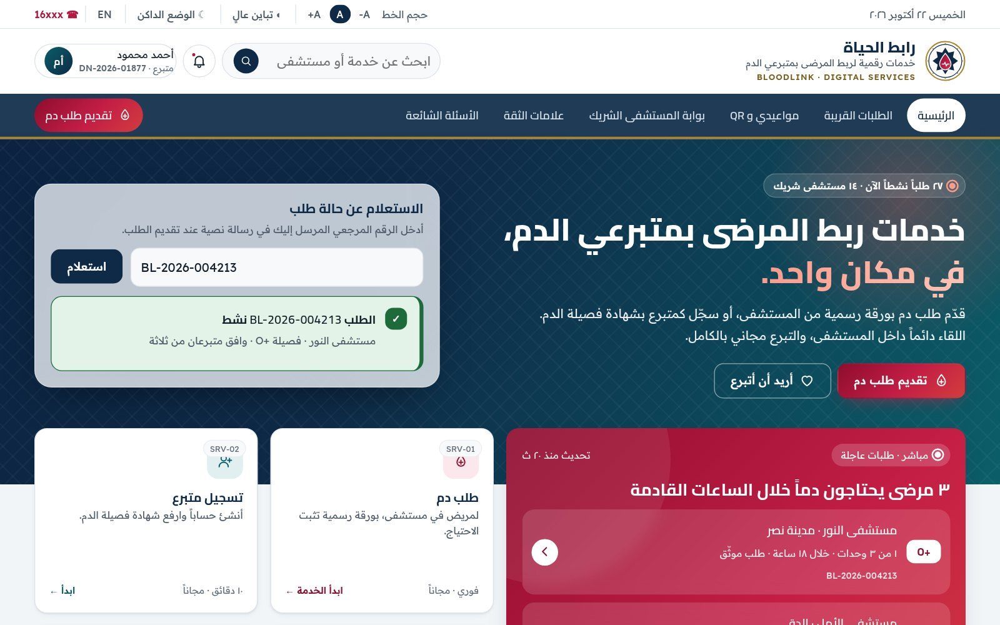

**New request, step 2: the hospital paper (desktop).** A 4-step form. The paper is sent to the partner hospital, and the result panel says what happens next.

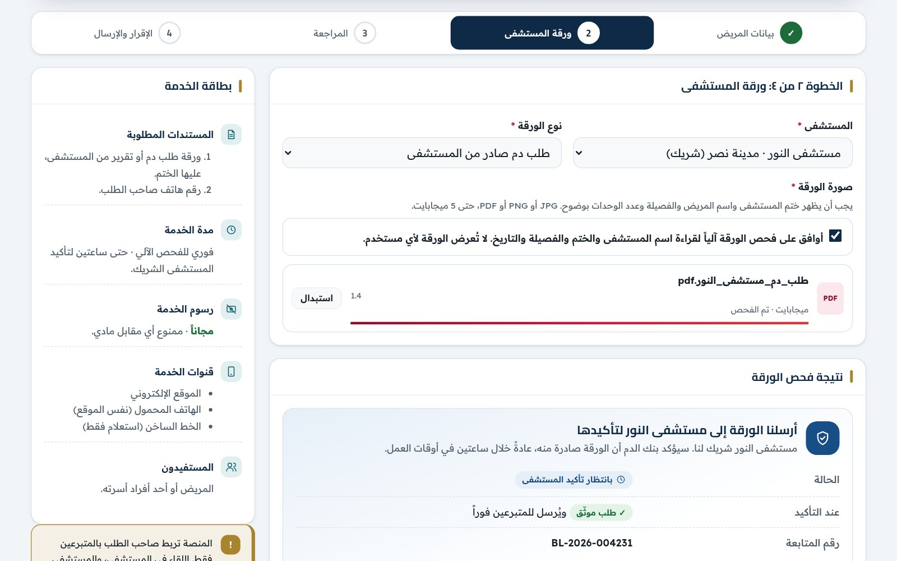

**Request progress (desktop).** "2 of 3 units have a donor", a timeline of what happened, and donors' phone numbers, shown only after they accept.

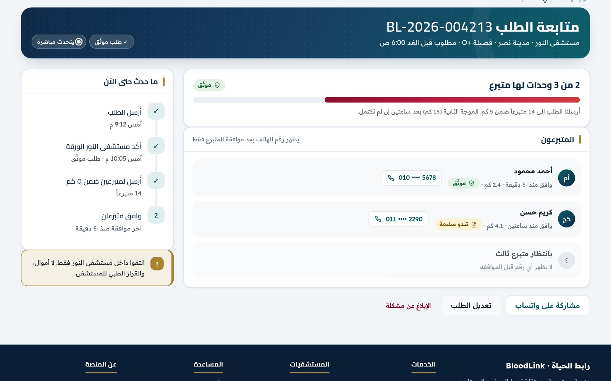

**Donor journey (phone).** Nearby requests → certificate checked by AI ("looks valid") → QR ticket at a partner hospital → "No QR at this hospital" at other hospitals.

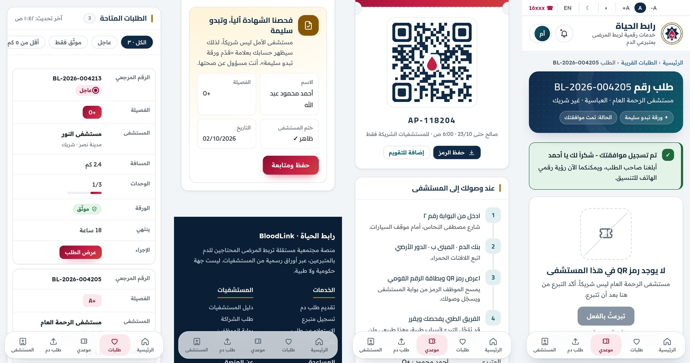

**Partner hospital dashboard (desktop).** Today's numbers, a QR scanner, and three big outcome buttons: Donated, Not able to donate today (medical decision), Didn't show up.

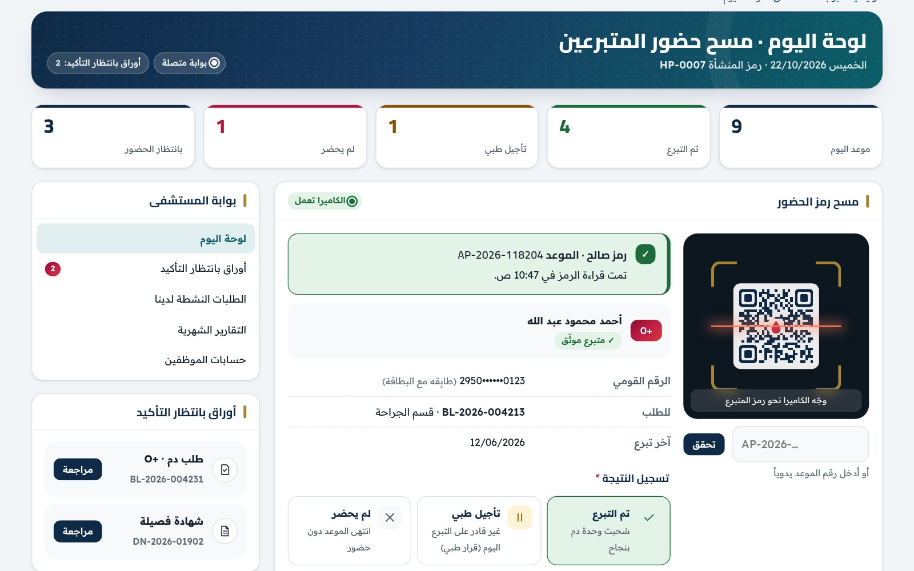

**Admin: unclear papers (desktop).** One paper at a time, with what the AI could read and the problems it found, and three actions.

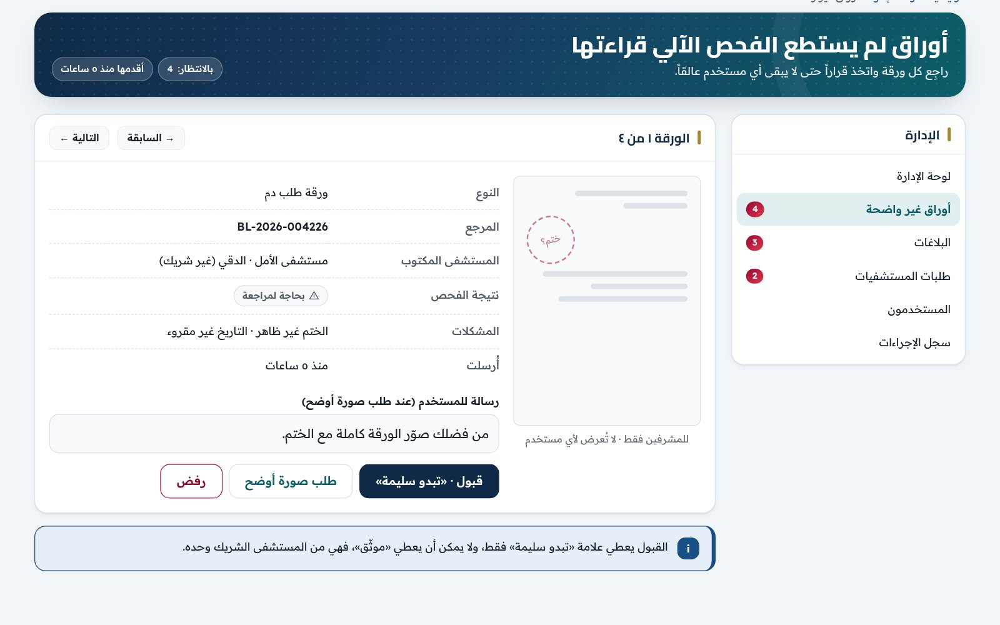

## 5. Visual design system

The style is a **modern public-service look**: navy and gold for trust (like a government service), crimson only for blood and urgency, lots of white space, rounded cards.

### Colours

Every colour is a named **token**. Components never use a raw hex value, so dark mode and high contrast work everywhere automatically. All text colours pass WCAG AA contrast.

| Token | Light | Dark | High contrast | Used for |
|---|---|---|---|---|
| `canvas` | `#F2F5F8` | `#0A131D` | `#FFFFFF` | Page background |
| `surface` | `#FFFFFF` | `#111E2B` | `#FFFFFF` | Cards, panels, inputs |
| `ink` | `#15202B` | `#E6EDF4` | `#000000` | Body text |
| `ink-2` | `#4D5A68` | `#A9B6C4` | `#000000` | Secondary text |
| `navy` | `#0E2A47` | `#173B60` | `#000000` | Structure: menu, table heads, headings |
| `teal` | `#0B5E68` | `#127A86` | `#000000` | Accents, selected menu item |
| `gold` | `#A9842F` | `#A9842F` | `#A9842F` | Decoration only: seal, rules, scanner corners |
| `crimson` | `#B3163E` | `#FF5A77` | `#8B0000` | Urgent, errors, blood types, main action |
| `ok` | `#1D6B3A` | `#4FD08F` | `#004D1A` | **Verified**, success |
| `warn` | `#865600` | `#FFB54D` | `#5A3A00` | **Paper looks valid**, warnings |
| `info` | `#174E86` | `#8CB4FF` | `#00337A` | Information, links, pending |
| `focus` | `#F2B705` | `#F2B705` | `#F2B705` | Keyboard focus ring |

The main buttons and hero use one gradient: `#8E0D2F → #C41E45 → #D13D3D`.

**Colour is never the only signal.** Trust badges always have an icon and a word, errors always have text, and blood types are always written out.

### Typography

Two Google fonts made for Arabic screens: **Cairo** for headings and **Readex Pro** for text.

| Style | Font | Size | Example |
|---|---|---|---|
| Hero title | Cairo 800 | 1.85 → 2.5 rem | خدمات ربط المرضى بمتبرعي الدم |
| Page title | Cairo 800 | 1.45 → 1.8 rem | طلبات قريبة تناسب فصيلتك |
| Section title | Cairo 800 | 1.15 rem | المستشفيات الشريكة |
| Card title | Cairo 700 | 1–1.08 rem | نتيجة فحص الورقة |
| Body | Readex Pro 400 | 1 rem (16 px), line height 1.75 | اللقاء دائماً داخل المستشفى |
| Small | Readex Pro 400–600 | 0.88 rem | لن نشارك رقم هاتفك إلا بعد موافقتك |
| Reference codes | Readex Pro 600, left-to-right | inherit | BL-2026-004213 |

Body text is never smaller than 16 px, and the line height is generous because Arabic letters need room above and below.

### Shape and spacing

| Element | Radius | Used for |
|---|---|---|
| Field | 12 px | Inputs, buttons |
| Tile | 14 px | Notices, stats, small cards |
| Card | 16 px | Cards and panels |
| Hero | 22 px | Page header, lookup box |

Spacing follows a 4 px scale (4, 8, 12, 16, 24, 32, 40). Two soft shadows: one for cards and one for raised elements.

**Icons:** one outline icon set (Lucide), always with a text label next to it, and hidden from screen readers when the label already says it.

## 6. Components

The UI is built from a small set of shared components, so every page looks and behaves the same.

| Group | Components |
|---|---|
| **Layout** | UtilityBar (text size, contrast, dark mode), Header, MainNav, BottomTabBar (phones), Breadcrumb, PageHeader, SideMenu, Footer |
| **Basics** | Button (primary, navy, line, ghost, link), TrustBadge, BloodTypeChip, Notice (info, success, warning, error), Toast |
| **Forms** | TextField, SelectField, Checkbox, Switch, FileUpload (with progress), Stepper |
| **Data** | DataTable (becomes cards on phones), Pager, KeyValueTable, Skeleton, EmptyState, ErrorState, PledgeProgress |
| **Dialogs** | BottomSheet, ConfirmDialog, ReportDialog |

**Trust badges** are the most important component. They look the same everywhere:

| Badge | Colour | Meaning |
|---|---|---|
| ✓ **Verified** (موثّق) | Green | The paper was issued by a partner hospital, and the hospital confirmed it |
| **Paper looks valid** (ورقة تبدو سليمة) | Amber | From another official hospital; the AI checked it. Not a guarantee |
| **Needs review** (بحاجة لمراجعة) | Grey | The AI couldn't read it; an admin will check it |

## 7. Screen states

Every screen is designed in **all its states**, not only the happy one. Each screen has at least **Success, Loading, Empty and Error**, plus its own special states:

| Screen | Special states |
|---|---|
| Nearby requests | Availability paused |
| Request details | Before accepting, accepted at a partner hospital (QR), accepted at a non-partner hospital (no QR), request closed |
| New request / Certificate | Uploading, checking, AI result, partner hospital, unclear → upload again, AI service down → review queue |
| Signup | Validation errors, submitting, account created |
| Confirm donation | Done, request expired |
| Hospital signup | Waiting for admin approval |

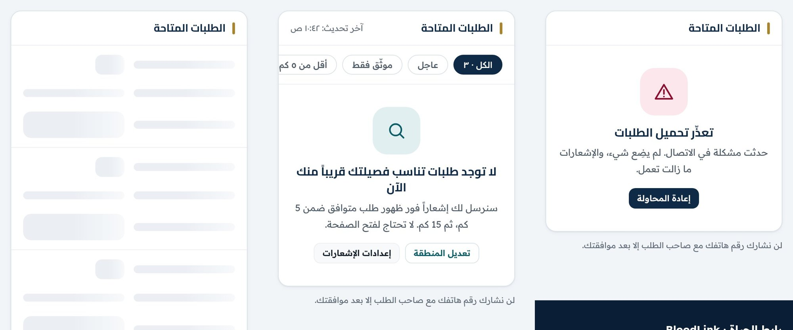

- **Loading** uses grey skeleton shapes in the same layout, so the page doesn't jump.
- **Empty** explains why and offers a next step ("We'll notify you when a compatible request appears within 5 km, then 15 km").
- **Error** says what happened in plain words, reassures ("nothing was lost"), and offers **Try again**.

## 8. Accessibility

Target: **WCAG 2.1 AA** and a Lighthouse accessibility score of at least 90.

| Feature | How |
|---|---|
| **Text size** | A− / A / A+ buttons in the utility bar on every page. Layout uses `rem`, so everything scales. |
| **High contrast** | A switch that turns the page black-on-white with thick borders |
| **Dark mode** | A switch in the utility bar |
| **Contrast** | All text colours pass AA (4.5 : 1). Gold is used only for decoration, never for small text. |
| **Keyboard** | Everything works with Tab, Enter and Space. A "skip to content" link comes first. |
| **Focus** | A thick yellow focus ring with a navy halo, visible on any background |
| **Screen readers** | Real headings and landmarks, labels on every field, `aria-live` for upload progress and live request updates, icons hidden when a text label exists |
| **Forms** | Labels above fields, required fields marked with text, errors written next to the field and summarised at the top |
| **Touch** | Tap targets at least 44 px |
| **Motion** | Animations turn off when the phone asks for reduced motion |

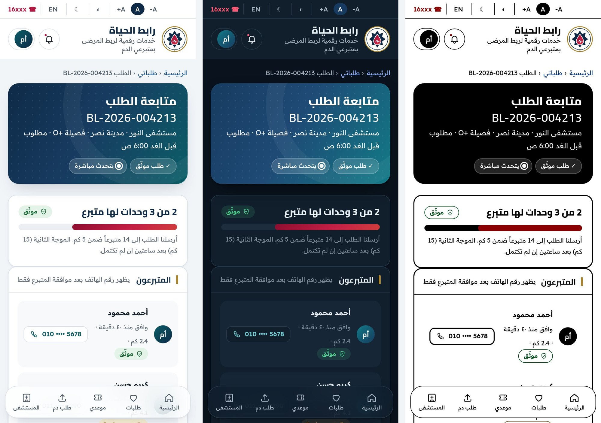

### Arabic and right-to-left

- The whole page is `dir="rtl"` and `lang="ar"`.
- Layout uses start/end, never left/right, so it mirrors correctly.
- Phone numbers, reference codes (BL-2026-004213) and blood types (O+) are kept left-to-right inside Arabic text, so they never come out scrambled.
- Dates and times use Egyptian Arabic formatting and Cairo time.

## 9. Responsive design

The design is **mobile first**: most requesters and donors will use a phone.

| Width | Layout |
|---|---|
| **360–639 px** (phones) | One column. Bottom tab bar. Tables turn into stacked cards. Side menus move above the content. |
| **640–767 px** | Header actions wrap below the logo |
| **768 px and up** (tablets) | Tables stay as tables. Two columns where useful. |
| **1024 px and up** (computers) | Full main menu, side menu next to the content, up to 4 cards in a row |

Every screen is designed for 1280, 768, 390 and 360 px wide.

## 10. Content and tone

- **Plain Arabic**, short sentences, no medical or legal jargon.
- **Say what happens next.** "We sent the paper to Al Nour Hospital. It usually confirms within 2 hours."
- **Never claim medical certainty.** "Paper looks valid", not "Paper is valid". "The hospital decides".
- **Repeat the 3 rules** where they matter: meet only inside the hospital, no money ever, the hospital makes the medical decision.
- **Privacy is visible.** "We won't share your phone number until you accept."
- **Reference numbers** on everything (requests, donors, appointments, reports), so people can talk to support about one exact item.

## 11. Usability testing plan

We will test the website with **5 people per round** (family and friends who match our users).

| # | Task | Success when | Target |
|---|---|---|---|
| 1 | As a requester, send a request for 3 units of O+ at Al Nour Hospital | Request sent with a paper | Under 3 minutes |
| 2 | Find out how many donors have accepted your request | Finds "2 of 3" on the progress page | Under 30 seconds |
| 3 | As a donor, upload your certificate | Sees the badge result | Under 2 minutes |
| 4 | Accept a nearby request and find where to go in the hospital | Opens the QR ticket and the directions | Without help |
| 5 | Turn on high contrast and make the text bigger | Uses the utility bar | Without help |

We watch, note where people hesitate, and fix the top problems before the next round. Results go into the Phase 6 test report.

## 12. From design to code

- **Design tokens in code:** the colours, fonts, sizes, radii and shadows above are defined once in `src/index.css` (Tailwind CSS v4), so every page uses exactly the same values and dark mode and high contrast work everywhere.
- **Shared components:** the components in section 6 are built once and reused by every page, with their variants and accessibility built in.
- **Every state for every screen:** each page is built with its loading, empty, error and success states, not only the happy one.
- **Checklist before merging:** every page is checked for keyboard use, focus, labels, text size, contrast, and the 390 and 360 px widths before it is merged.
- **Built with:** React, Vite and Tailwind CSS v4, in JavaScript (see the README).
